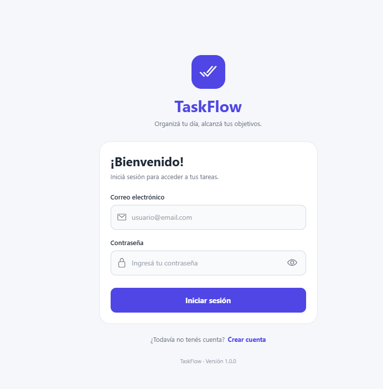
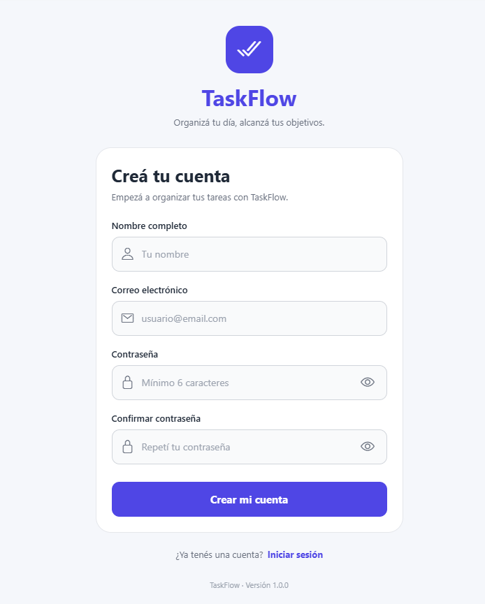
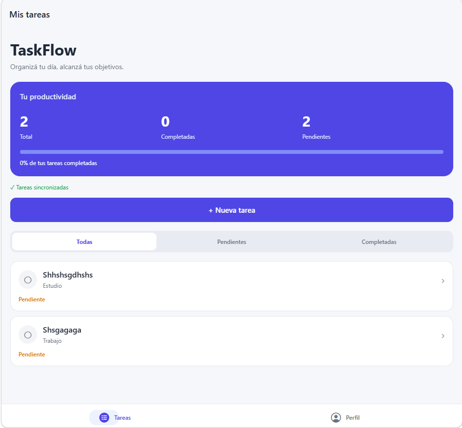
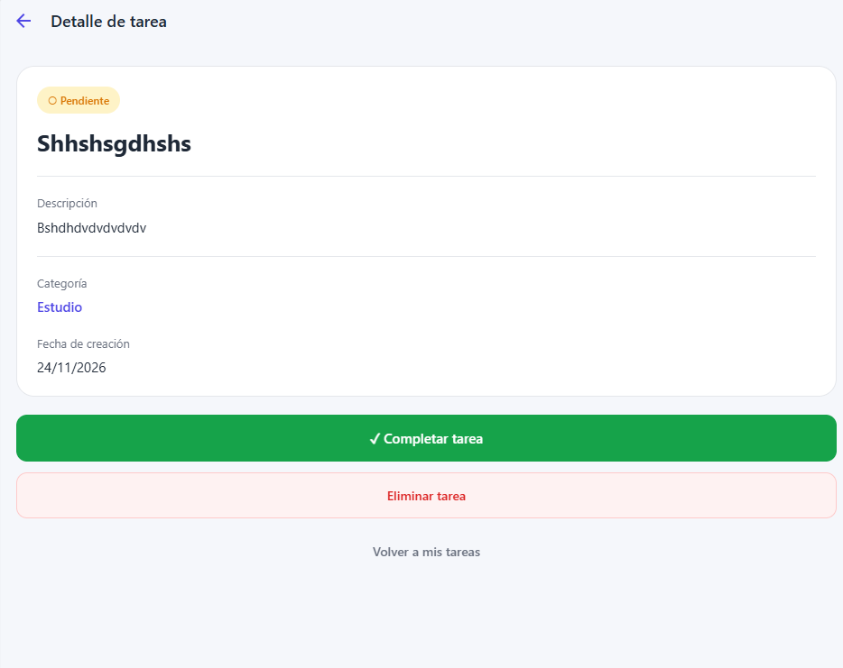
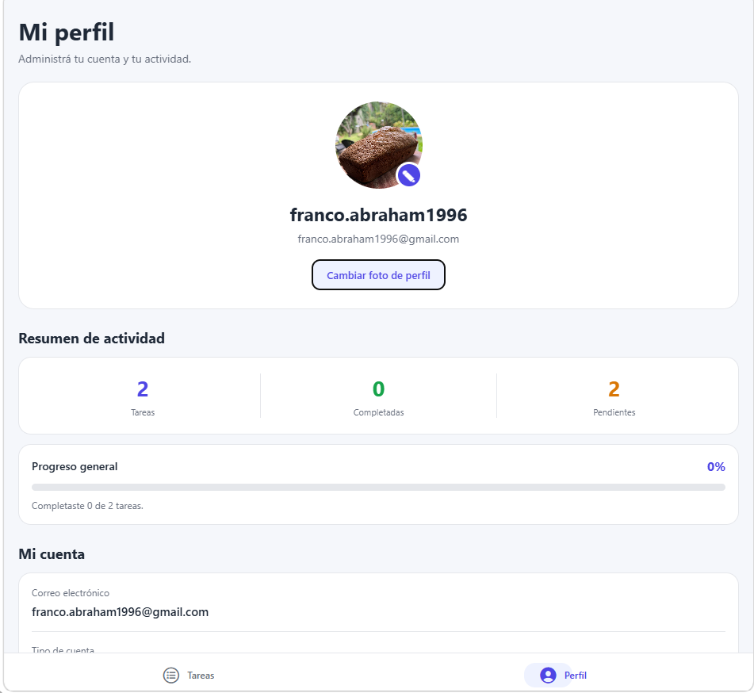

# TaskFlow

Aplicación móvil de gestión de tareas desarrollada con React Native y Expo como proyecto final del curso de Desarrollo de Aplicaciones.

## Funcionalidades

- Registro e inicio de sesión con Firebase Authentication.
- Persistencia de sesión.
- Creación, visualización y eliminación de tareas.
- Clasificación de tareas por categorías.
- Filtros de tareas pendientes y completadas.
- Sincronización en tiempo real con Firestore.
- Gestión del estado global mediante Redux Toolkit.
- Perfil personalizado con Expo ImagePicker.
- Persistencia local de la foto de perfil.
- Cierre de sesión seguro.
- Navegación mediante Bottom Tabs y Stack.
- Indicadores de carga y estados de sincronización.

## Tecnologías utilizadas

- React Native
- Expo
- JavaScript
- Redux Toolkit
- React Navigation
- Firebase Authentication
- Cloud Firestore
- Expo ImagePicker
- Expo FileSystem
- AsyncStorage
- Expo Vector Icons

## Instalación

1. Clonar el repositorio.
2. Ejecutar `npm install`.
3. Crear un archivo `.env` utilizando `.env.example` como referencia.
4. Completar las variables con la configuración de Firebase.
5. Habilitar Authentication con correo y contraseña.
6. Configurar Firestore utilizando las reglas de `firestore.rules`.
7. Ejecutar `npx expo start`.

La aplicación puede ejecutarse desde Expo Go o desde el navegador presionando la tecla W.

## Arquitectura

El proyecto utiliza una estructura modular organizada en componentes, pantallas, navegación, servicios, hooks personalizados y Redux.

El hook useTaskSync permite mantener sincronizadas las tareas de Firestore con el estado global de Redux.

## Seguridad

Las reglas de Firestore restringen el acceso a las tareas según el identificador del usuario autenticado.

La configuración de Firebase se administra mediante variables de entorno.

## Capturas de pantalla

### Inicio de sesión

### Registro

### Lista de tareas

### Detalle de tarea

### Perfil personalizado

## Autor

Franco Abraham

Proyecto final del curso de Desarrollo de Aplicaciones.

2026.

## Aplicación desplegada

TaskFlow fue compilado mediante EAS Build para Android.

- [Descargar e instalar TaskFlow (APK)](https://expo.dev/accounts/francoab96/projects/taskflow/builds/58f372bb-c1cc-4eaa-b263-873dc8c6e455)

La aplicación puede instalarse sin necesidad de Expo Go.
